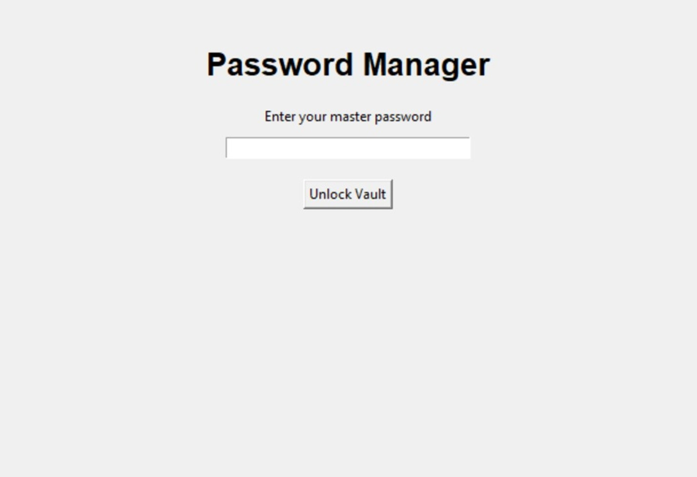
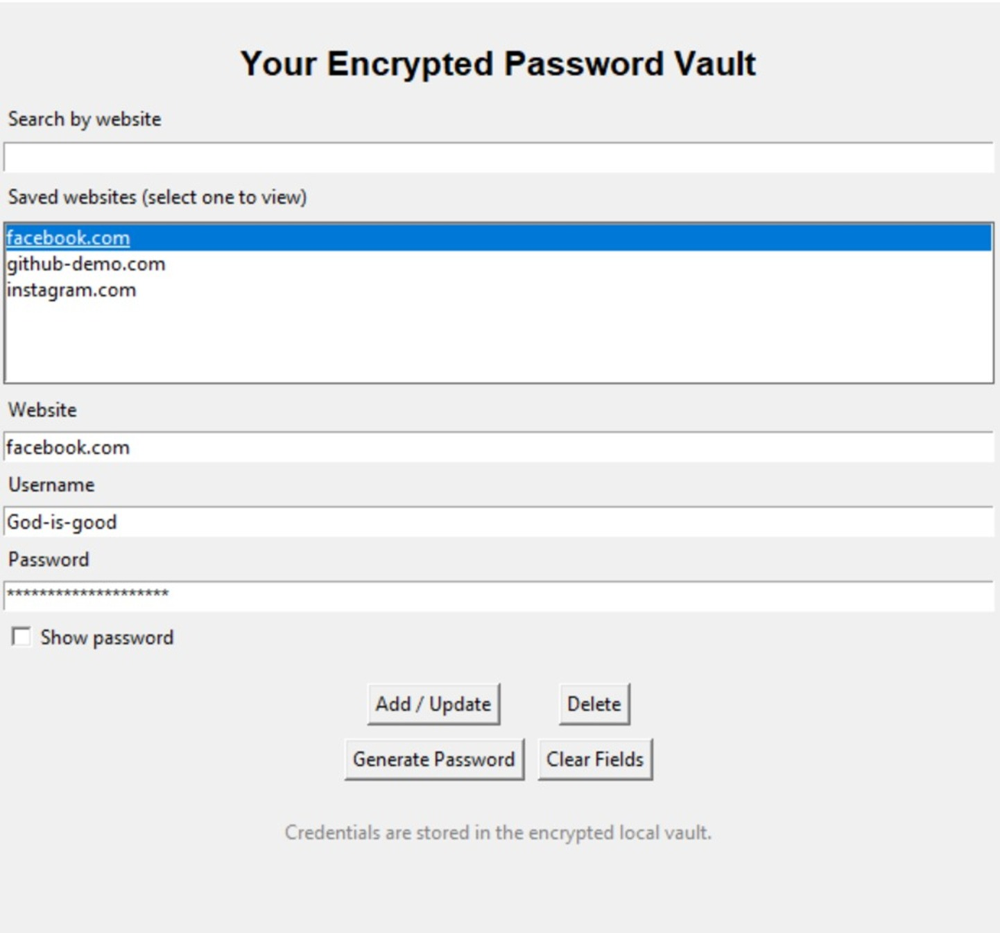
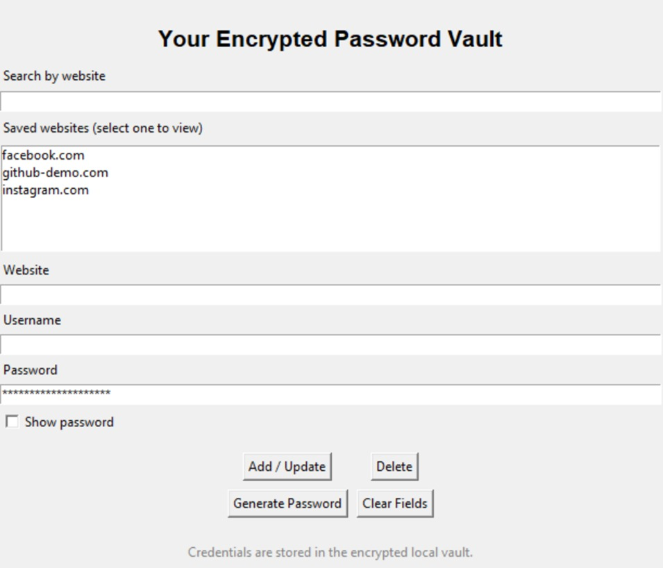

# Python Password Manager

A password manager built with Python that securely stores account credentials using encryption. The project includes a command-line implementation and a graphical user interface (GUI).

## Features

- **Master Password:** Unlocks access to the password vault.
- **Key Derivation:** Uses PBKDF2-HMAC with SHA-256 and 600,000 iterations to derive an encryption key.
- **Encryption:** Uses Fernet symmetric encryption to protect stored credentials.
- **Password Generation:** Generates strong random passwords using Python's `secrets` module.
- **Graphical Interface:** Provides a Tkinter GUI for managing saved accounts.
- **Vault Management:** Add, view, and delete account credentials.
- **Error Handling:** Handles incorrect master passwords and invalid vault data.

## Technologies Used

- Python
- Tkinter
- Cryptography (Fernet and PBKDF2HMAC)
- JSON

## Project Structure

```text
password-manager/
├── password_manager.py
├── password_manager_gui.py
├── .gitignore
├── README.md
└── screenshots/
    ├── login-screen.jpeg
    ├── main-interface.jpeg
    └── password-management.jpeg
```

## Screenshots

### Login Screen


### Main Interface


### Password Management


## Security Notes

- Vault credentials are encrypted before being stored.
- The master password is used to derive the encryption key; it is not stored as the encryption key itself.
- Local vault files (`vault.dat` and `vault.salt`) are excluded from Git using `.gitignore`.
- This is a learning project and has not undergone a professional security audit.

## Learning Outcomes

This project provided practical experience with Python file handling, password-based key derivation, encryption and decryption, GUI development, and secure credential management.
